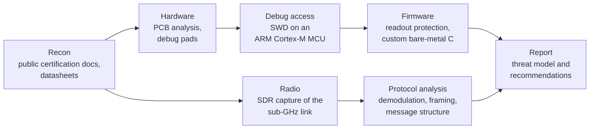

# Security analysis of a commercial IoT alarm system

My bachelor's thesis (Computer Engineering, Universitat Pompeu Fabra, 2026-2027): taking apart a consumer wireless alarm to see how it's built and how safe it really is.

Wireless alarms protect millions of homes, and independent public analyses of modern ones are rare. I wanted to learn embedded security by doing it, so I took a system I own (monitoring contract cancelled, SIM removed) and went through it from the outside in: the debug interfaces on the boards, the firmware, and the radio link between the sensors, the siren and the panel.

This repo only introduces the concept and the method. Code, captures and findings stay private until the thesis is defended and any issue has gone through responsible disclosure.

## Ground rules

Everything happens in a lab, on hardware I own, with the siren volume under control (it is a siren, after all). Nothing is tested against third-party systems or live services, and nothing identifying the vendor or product will be published before disclosure.

## Method

I start with public radio-certification documents, which come with test reports and internal photos, and with component datasheets. That tells me what's on the boards and what the radio does before I open anything.

Then comes the hardware: finding the microcontroller, the radio and the debug pads. The microcontroller had its debug port locked. My probe couldn't get past the lock, and the option left was a full chip erase, which reopens the port but destroys the original firmware and its keys. I weighed that trade-off and documented it before doing it. Once the port was open, the siren started running my own bare-metal C firmware, which proves I have full control of the hardware (it makes tones now).

For the radio, I capture traffic in a sub-GHz band with a software-defined radio, then demodulate it and work out the modulation, bit rate, frame structure and which parts are encrypted. About 150 messages captured and analysed so far. The report will cover a threat model, findings by impact, and recommendations for manufacturers and users.

## Lab

A software-defined radio receiver, a debug probe and a multimeter, with open-source tools: OpenOCD, Ghidra, Universal Radio Hacker, SDR++ and a GCC toolchain for ARM.

## Where it is (October 2026)

- Debug access done on the siren, which now runs custom firmware.
- Radio link characterised at the physical and frame level.
- The camera and control panel are next. They're better shielded and their chips aren't identified yet.
- Next for the firmware: hardware timers, low-power modes, and a Wi-Fi gateway so the siren can join a home-automation setup.
- Written report in June 2027, defence in July.

## What it's teaching me

Embedded C, ARM Cortex-M, SWD debugging, firmware analysis, RF protocol analysis, threat modelling and responsible disclosure.

---

© 2026 Arnau Mas
